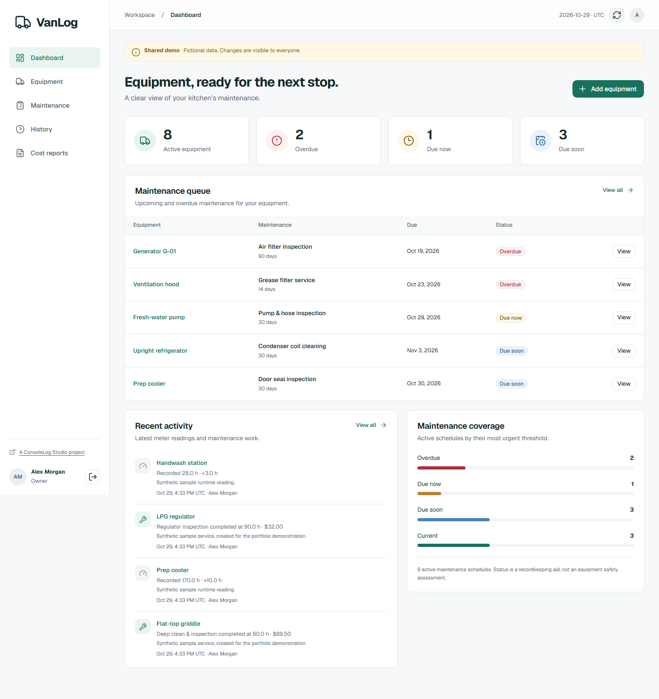
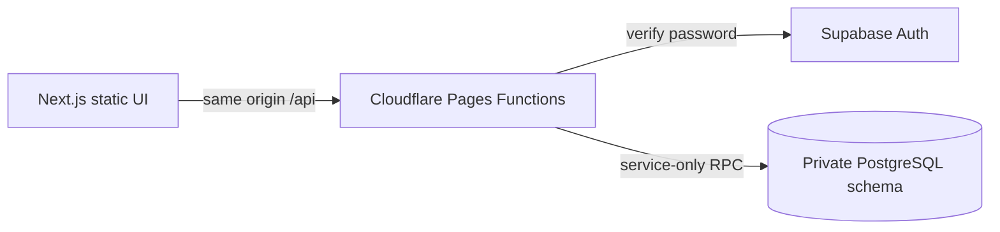

# VanLog

A maintenance workspace for food trucks and mobile kitchens. Built as a **self-initiated ConsoleLog Studio portfolio project**, using fictional shared data.

[Live demo](https://vanlog-consolelog.pages.dev) · [Source brief](files/consolelog-project-build-briefs.md) · [Acceptance evidence](docs/acceptance.md) · [Case study](docs/case-study.md)



Owners manage equipment and schedules, review the maintenance queue, and export costs. Staff open a QR-linked record, log cumulative hours, and complete service. Both demo roles are available from the public introduction without entering credentials.

## Run locally

Use Node **24.14.0**, npm, and the existing hosted Supabase project. No local Supabase stack is required to run the app.

```sh
npm ci
# Copy .dev.vars.example to .dev.vars and supply private credentials.
npm run check
npm run build
npm run preview
```

Open `http://localhost:8788`. `npm run preview` serves the actual static build and Pages Functions together. `npm run dev` alone runs the Next.js frontend and does not provide the API. Rebuild after frontend edits; Wrangler watches Function changes. A small post-build compatibility step adds the prefetch filenames Next.js 16.4 expects when exporting on Windows; it does nothing on Linux.

## Architecture



- Next.js App Router, TypeScript, Tailwind CSS, official shadcn/ui Radix components, self-hosted Geist, Lucide icons.
- `out/` contains static files only. All runtime endpoints are in `functions/`.
- Equipment created after deployment opens at `/equipment/view/?id=UUID`. QR labels use `/equipment/UUID`; a Pages Function redirects to the static detail page and sign-in preserves that destination.
- Supabase Auth verifies operator-provisioned email/password accounts. The backend issues a separate opaque, eight-hour session. Production cookies are `Secure`, `HttpOnly`, host-only and `SameSite=Strict`; only a digest is stored in PostgreSQL. Local HTTP development uses a separately named cookie.
- Domain tables live in the non-exposed `vanlog` schema with RLS and revoked anonymous/authenticated grants. The browser receives no Supabase credential or upstream Auth token. Roles come from protected account profiles.
- Each mutation runs inside one database function transaction, including conditional version checks, history and the idempotency receipt. A single business settings row serializes writes to enforce capacity and concurrency rules. This deliberately favors correctness for this small deployment over multi-business throughput.

## Configuration

Never commit `.dev.vars`, `.secrets/`, Auth credentials, service keys or backups. The Supabase project URL is an identifier, not a credential. Cloudflare production and previews hold credentials as encrypted secrets.

| Setting                                   | Visibility / purpose                                         |
| ----------------------------------------- | ------------------------------------------------------------ |
| `SUPABASE_URL`                            | Public identifier for the selected hosted project            |
| `APP_ORIGIN`                              | Exact application origin; local value belongs in `.dev.vars` |
| `BUSINESS_TIME_ZONE`                      | Public IANA business timezone, selected UTC                  |
| `BUSINESS_CURRENCY`                       | Public USD/BDT; selected USD, locked once a service exists   |
| `DEMO_MODE`                               | Public boolean; selected `true`                              |
| `SUPABASE_PUBLISHABLE_KEY`                | Server binding used for password verification                |
| `SUPABASE_SECRET_KEY`                     | Privileged server-only secret / legacy service-role key      |
| `RATE_LIMIT_SECRET`                       | Server-only random secret, at least 32 characters            |
| `DEMO_OWNER_EMAIL`, `DEMO_OWNER_PASSWORD` | Server-only dedicated sample identity                        |
| `DEMO_STAFF_EMAIL`, `DEMO_STAFF_PASSWORD` | Server-only dedicated sample identity                        |
| `QA_OWNER_*`, `QA_STAFF_*`                | Local verification only; never deployed                      |

Public registration, anonymous sign-in and manual identity linking are disabled. Demo entry is enabled only in demo mode. For a real business, create a separate Supabase project with private accounts and `DEMO_MODE=false`; never put customer records into this public sandbox. The public introduction remains a portfolio introduction for this build.

## Operator procedures

All commands use the ignored `.dev.vars`. They run locally with the privileged key and have no visitor-accessible administrative endpoint.

```sh
npm run operator -- setup-demo
npm run operator -- seed
npm run operator -- provision --email operator@example.com --name "Operator" --role owner
npm run operator -- rotate --email operator@example.com
npm run operator -- disable --email operator@example.com
npm run operator -- backup
npm run operator -- cleanup
```

`provision` and `rotate` write generated 256-bit passwords to ignored `.secrets/` files and revoke existing application sessions. Provisioning an existing identity sets the supplied/generated password and enables its profile. `disable` revokes sessions and bans the Auth identity. Password recovery is an operator rotation, including recovery when all owners lose access; no email delivery is required. There is a ten-account limit.

`seed` refuses a nonempty equipment collection. It creates eight fictional kitchen records and nine tasks spanning every due state. Only an operator can reset the shared demo:

```sh
npm run operator -- demo-reset --confirm-project gvtazbiscsopygddtclb
```

Reset exports a backup first, removes the demo's equipment/history, and reloads the sample fixture with fresh IDs and dates. Previously downloaded QR labels must be regenerated. No scheduled reset runs. `cleanup` deletes expired sessions, rate buckets and receipts in bounded batches. Run it during normal operator maintenance; inspect provider usage before widely sharing the demo.

### Backup and recovery

`backup` exports versioned **application data** to ignored `backups/`. It preserves equipment, task baselines, readings, services, profile IDs and exact costs. It deliberately excludes session tokens/digests, receipts, passwords and Supabase Auth credentials. It is not a full Supabase project/Auth backup. Keep a protected copy outside this checkout and use Supabase's supported database backup/export process for broader disaster recovery.

```sh
# Docker Desktop must be running. Uses an isolated, disposable PostgreSQL 17 container.
npm run test:restore

# Validate and replace application data in the explicitly named configured project.
npm run operator -- restore --file backups/vanlog-TIMESTAMP.json --confirm-project gvtazbiscsopygddtclb
```

Restore validates the complete file before replacement, exports the current state, and replaces records transactionally. It revokes sessions and disables restored profiles. Rebind an existing profile with `provision --account-id UUID` using the same profile ID from the backup; this preserves historical actors. Reprovision every account that needs access. The local restore test applies all versioned migrations to PostgreSQL 17 and checks IDs, counts, report totals, rollback and limits. It does not replace the live dataset.

Apply migrations in filename order through the Supabase CLI or SQL tooling, after a backup and restore rehearsal. The supplied project already has the included migrations. Never run `db reset` against it. A code rollback does **not** reverse a database migration; repair schema changes with a forward migration, or use a reviewed backup restore during a maintenance window. The original brief's D1-specific testing instructions are adapted to actual hosted Supabase/PostgreSQL integration.

### Immutable history and corrections

Readings and services cannot be edited or deleted by visitors. For a physical meter replacement, archive the old equipment, create a new record at the replacement counter, and record the old/new IDs in a note on the first new reading. For mistaken historical data: stop writes, take a backup, prepare a narrowly scoped SQL correction with the original and proposed values plus the operator/reason/time, rehearse it on a restored local copy, verify totals and affected schedules, then apply it transactionally through privileged database tooling. Keep the audit record with protected backups. There is intentionally no generic correction button or unreviewed correction script.

## Checks

```sh
npm run check                   # TypeScript, ESLint, Vitest
npm run build                   # Static production build
npm run operator -- setup-qa     # Dedicated local QA account credentials
npm run test:integration         # Pages Functions + actual hosted PostgreSQL
npx playwright install          # One-time browser installation if needed
npm run test:e2e                 # Chromium / Firefox / WebKit
npm run test:restore             # Actual export into disposable PostgreSQL 17
npm run capture                  # Portfolio screenshots and a 42-second staff clip
# Set TEST_ORIGIN to the canonical live origin for the deployed benchmark.
npm run benchmark                # Ten concurrent sessions; writes JSON evidence
```

Integration and browser tests create `QA-...` equipment and immediately save their IDs to an ignored manifest. Cleanup removes only IDs in that manifest and verifies the QA prefix in PostgreSQL. If interrupted, use `npm run operator -- test-cleanup --file .secrets/MANIFEST.json`. Automated tests never reset the complete demo. Local browser tests use reserved synthetic test IPs to isolate independent runs; production Cloudflare supplies its trusted client IP.

GitHub Actions and the Pages build run type checks, lint, unit tests and the production build without hosted credentials. Integration, browser and restore checks are explicit release checks with private local access. Actual results and remaining limits are in [the acceptance record](docs/acceptance.md).

## Deployment and limits

Cloudflare Pages is connected to `shawalkabirchy/vanlog`, production branch `main`, build command `npm run check && npm run build`, output `out`, Node 24.14.0. The preferred `vanlog.pages.dev` was unavailable; the live address uses the agreed `vanlog-consolelog.pages.dev` fallback. Future branch previews share the same fictional dataset. Preview origins are restricted to direct subdomains of the canonical Pages hostname in demo mode; cookies remain host-only.

- 100 total equipment records, 20 total tasks per equipment, ten accounts, and 10,000 combined demo readings/services, including archived records.
- Runtime is integer minutes, multiples of six, maximum 100,000 hours. Cost is integer minor units, maximum 10,000,000.00 per service.
- Due status uses the more urgent day/hour threshold. Calendar dates use UTC in this deployment. “Due soon” means within seven days or within 10% of the runtime interval.
- Mutation receipts last 24 hours. A later retry whose record already exists returns `REQUEST_ALREADY_RECORDED`; it never duplicates the record.
- Requests are capped at 64 KiB. Login is limited to ten attempts per 15 minutes per daily IP HMAC, authenticated writes to 60 per minute per account. Raw IPs and request bodies are not logged.
- Read responses are uncached. Reads retry twice after one and three seconds; writes require explicit retry of the frozen original payload. There is no offline queue or cross-device draft recovery.
- No paid resources enabled. Free provider quotas, suspension/pausing, network distance and availability still apply. No uptime or equipment-safety claim is made.

No billing, AI, uploads, sensors, SMS, native app, visitor account management or scheduled reset is included. Dependency licenses and upstream sources are listed in [third-party notices](docs/third-party-notices.md).
