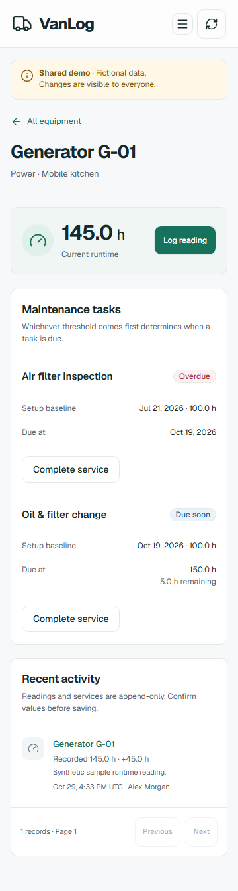

# VanLog: equipment maintenance between stops

**Self-initiated ConsoleLog Studio portfolio project.** No client commission, customer adoption, revenue, failure prevention or measured business savings is claimed.

Food trucks combine cooking, power, refrigeration and water equipment in a small workspace. Maintenance records need both a short staff workflow and a useful owner view. This project explores that combination with synthetic data.

## The workflow

An owner creates a generator at 100 operating hours and adds an oil-change interval of 50 hours. A staff member opens its QR link, signs in, and enters the cumulative counter. At 145 hours the task is due soon; at 150 it is due now; above 150 it is overdue. A service completion records the current meter, business date, actor, note and cost in one transaction. The owner's history and cost report reflect the same record.

## Design decisions

The interface uses a quiet white-and-forest palette, a desktop navigation rail and a compact mobile header. Each maintenance state has a word as well as a color. The public introduction has separate owner and staff entry buttons so portfolio visitors can experience the permission boundary directly.

The important interaction is the cumulative counter. A preview shows the previous value and increase, and a jump above 24 hours requires a second confirmation. A stale record requires a refresh and review. If a response is lost, the form keeps its values and offers a retry of the original request rather than guessing whether the server saved it.

## Engineering decisions

Next.js exports static pages to Cloudflare Pages. Same-origin Pages Functions call hosted Supabase Auth and PostgreSQL. Equipment details use a static query route; permanent QR entry routes redirect to it, so adding equipment requires no frontend rebuild.

The browser never receives a privileged database credential. Profiles protect owner/staff roles, and short-lived application sessions use HttpOnly cookies. Database transactions serialize competing writes and store an idempotency receipt together with the history record. Money is integer minor units; runtime is integer minutes. Historical records stay append-only.

A single business settings-row lock enforces the small deployment's record caps and prevents concurrent conditional writes from creating conflicting history. This is an intentional limit for a single-business portfolio application; a high-volume fleet product would need a different locking and tenancy design.

## Evidence and limits

[Acceptance results](acceptance.md) link each critical behavior to the actual test, hosted integration and restore evidence. Browser screenshots and the walkthrough demonstrate working UI with synthetic records. The backup rehearsal restores exported application records into disposable PostgreSQL 17 and compares IDs, counts and exact costs.

The demo is shared and writable; visitors can change its sample data. Free provider quotas and availability apply. Phone-camera scanning and real kitchen operations need separate real-device and operational validation. The app records maintenance and does not certify equipment safety or predict failures.

## Delivery

[Live demo](https://vanlog-consolelog.pages.dev) · [GitHub](https://github.com/shawalkabirchy/vanlog) · [Walkthrough notes](walkthrough.md) · [LinkedIn drafts](linkedin-drafts.md)
